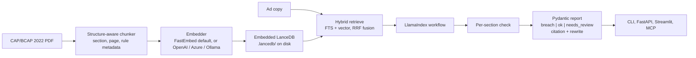

# Ad Compliance Checker

A Retrieval-Augmented Generation showcase that reviews **gambling and lottery
advertising copy** against the UK CAP/BCAP Advertising Guidance
[*Gambling and lotteries advertising: protecting under-18s*](https://www.asa.org.uk)
(published April 2022).

This is a technical demonstration of a modern LlamaIndex 0.14 RAG stack, not
legal advice. The source document is Advertising Guidance from the Committee
of Advertising Practice (CAP) and the Broadcast Committee of Advertising
Practice (BCAP). It is interpreted by the ASA, **does not bind the ASA
Councils**, and is **not** a Gambling Commission licence condition.

The public repository name is still `llamaindex-python-rag` for historical
reasons. The project itself is the Ad Compliance Checker.

## Why this exists

A generic "chat with a PDF" demo does not show much. This one is a narrow,
regulated task:

1. Ingest one official guidance PDF, keeping section numbers, titles and pages.
2. Retrieve with **hybrid search** (LanceDB full-text + vectors, fused with RRF).
3. Run a LlamaIndex **workflow**: retrieve → check each retrieved section →
   aggregate a structured verdict (`breach`, `ok`, or `needs_review`) with a
   verbatim citation and an optional rewrite.
4. Measure retrieval hit-rate, verdict accuracy and citation faithfulness
   against 40 hand-written, **synthetic** ad snippets.

Providers are pluggable: FastEmbed (default, local, no key) for embeddings;
OpenAI, Azure OpenAI or Ollama for the judge.

## Architecture



The default path is local and key-free until you ask for a verdict. Ingest
and `debug-retrieve` run on FastEmbed plus LanceDB. `check`, the HTTP API,
the Streamlit demo and the MCP tool need an LLM provider.

## Quickstart (no Docker)

Python 3.12+ and [uv](https://docs.astral.sh/uv/) are enough.

```bash
git clone https://github.com/snikidev/llamaindex-python-rag
cd llamaindex-python-rag
uv sync
cp .env.example .env          # optional until you run a verdict
uv run ad-compliance ingest   # local FastEmbed; writes .lancedb/
uv run ad-compliance debug-retrieve "cartoon Santa slots ad"
```

To produce a structured verdict, set a provider in `.env` (for example
`OPENAI_API_KEY`, or Azure / Ollama — see `.env.example`) and run:

```bash
uv run ad-compliance check "New cartoon slots! Help Santa and his cuddly elf pals open magical loot sacks."
uv run ad-compliance check --file ./ad.txt --json
```

Or from git without a full checkout:

```bash
uvx --from git+https://github.com/snikidev/llamaindex-python-rag ad-compliance --help
```

`uvx` still needs a writable working directory for `.lancedb/` and a first
`ingest` in that directory. The guidance PDF is bundled with the package; the
index is **not** shipped pre-built, because it is cheap to rebuild locally
with FastEmbed and stays consistent with the embedder you actually use.

### Commands

| Command | What it does | Needs an LLM? |
| --- | --- | --- |
| `ad-compliance ingest` | Chunk the PDF and upsert into LanceDB | No |
| `ad-compliance debug-retrieve QUERY` | Show ranked passages, scores, citations | No |
| `ad-compliance check TEXT` | Structured per-rule verdict | Yes |
| `ad-compliance eval --retrieval-only` | Retrieval hit-rate on the synthetic set | No |
| `ad-compliance eval --verdicts` | Also score the judge | Yes |
| `ad-compliance serve` | FastAPI at `/check` and `/retrieve` | For `/check` |
| `ad-compliance demo` | Streamlit UI | For a full check |
| `ad-compliance mcp` | FastMCP `check_ad` tool on stdio | Yes |

An agent-facing skill lives at
[`skills/ad-compliance-check/SKILL.md`](skills/ad-compliance-check/SKILL.md)
(catalog-friendly folder layout for Claude Code, Cursor, OpenCode and
OpenChamber).

Docker is optional and not required for the quickstart:

```bash
docker compose up demo   # Streamlit on :8501
docker compose up api    # FastAPI on :8000
```

## Evaluation

The eval set at [`evals/snippets.json`](evals/snippets.json) contains **40
synthetic advertisements** written for this repository: 14 clear breaches, 13
clearly ok, 13 borderline. They are not taken from real campaigns. Each item
is labelled with an overall verdict and the guidance section numbers a
retriever ought to surface.

Metrics:

- **Retrieval hit-rate** — did any labelled section number appear in the
  retrieved set?
- **Verdict accuracy** — did the overall label match (`breach` / `ok` /
  `needs_review`)?
- **Citation faithfulness** — is each reported quote actually present in the
  retrieved guidance (string match, not a second LLM)?

Reproduce:

```bash
uv run ad-compliance ingest
uv run ad-compliance eval --retrieval-only
# requires a configured LLM provider:
uv run ad-compliance eval --verdicts
# or
make eval
```

Published scores are **not** filled in below. A full judge run was not
executed when this README was written (no provider API key in that
environment). Do not treat empty cells as zeros or as implied results.

| Metric | Score | How to reproduce |
| --- | --- | --- |
| Retrieval hit-rate | _not run — placeholder_ | `uv run ad-compliance eval --retrieval-only` |
| Verdict accuracy | _not run — placeholder_ | `uv run ad-compliance eval --verdicts` |
| Citation faithfulness | _not run — placeholder_ | `uv run ad-compliance eval --verdicts` |

After you run the eval, paste the printed percentages into the table and
note the embedder, the LLM, and the date.

Unit tests in CI use stubs and mock embeddings. They never call a model
API and they never publish a score for this table.

## Trade-offs

**Chunking.** The PDF is split on numbered guidance sections (1–30) and
checklist headings, then windowed to about 1,400 characters with a small
overlap. That keeps a citation pointed at "Section 20, pages 28–29" instead
of an arbitrary token window. The cost is that a long section such as the
exemptions in section 15 becomes several chunks, and a checklist
cross-reference is only as good as the heading parser.

**Hybrid vs vector-only.** Gambling guidance is full of precise phrases
("loot boxes", "Santa Claus", "under-25s"). Keyword match catches those
even when the embedding is a local MiniLM-class model. Pure vector search
is better at paraphrase ("festive cartoon mascot") and worse at rare
terms. Hybrid with Reciprocal Rank Fusion is the default; `debug-retrieve
--query-type vector` and `--query-type fts` are there so you can compare.

**Rerank cost.** The default rerank is LanceDB's local RRF fusion — no
extra model, no extra spend. `AD_COMPLIANCE_RERANKER=llm` can call the
configured judge to rerank, which is usually sharper and always slower and
more expensive. A cross-encoder was deliberately left out of the default
dependency set.

**LanceDB vs Qdrant.** An embedded LanceDB folder means `uv run` just
works: no Docker, no server, hybrid FTS built in, fine for a single-user
showcase and for CI. Qdrant (or Azure Cosmos, which is what an earlier
version of this repo used) is the better choice once several writers, a
hosted demo, or filter-heavy metadata query enter the picture. The code
is wrapped so the store is replaceable; the default stays embedded.

**Embedded vs server.** A server index is easier to share and to back up,
and you can scale search independently of the app. It also means a
moving part in the demo path. This project keeps the server as an optional
`docker compose` for the UI, not as a requirement for ingest or eval.

**Embeddings.** FastEmbed (`BAAI/bge-small-en-v1.5`) is the default so a
clone can ingest offline after one model download. OpenAI or Azure
embeddings will generally retrieve more cleanly and will **not** be
compatible with an index built on FastEmbed — rebuild with `ingest
--rebuild` if you switch.

## Limitations

- The index is this one 2022 guidance note, not the full CAP or BCAP Codes
  and not later ASA rulings.
- Personality and targeting questions often cannot be closed without
  audience data; those cases should come back `needs_review`.
- The judge can still hallucinate a quote; the eval measures that, and the
  workflow rewrites unfaithful quotes to a real excerpt when it can.
- Nothing here is a clearance, a legal opinion, or a statement by CAP,
  BCAP, the ASA, or the Gambling Commission.

## Development

```bash
uv sync
uv run pytest
uv run ruff check .
uv run ruff format --check .
```

CI on `main` runs ruff and pytest on Ubuntu with Python 3.12, without any
provider keys.

## Licence

MIT. The bundled PDF is official Advertising Guidance, included here as
the corpus for this demonstration. Check the publisher's terms if you
reuse it elsewhere.
